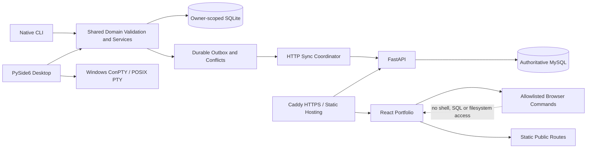

# MYCMD 2.0

MYCMD is an offline-first personal command centre with a native Python CLI, a
PySide6 desktop application, a real operating-system terminal, and a restricted
public React portfolio.

**Canonical repository:** https://github.com/Yousif-Sahito/MYCMD
**Primary development platform:** Windows
**CI platforms:** Windows and Ubuntu
**Current status:** Phases 0-10 implemented and Phase 10 exact-SHA CI verified

> MYCMD does not expose the public portfolio terminal as a shell. The local desktop
> terminal executes real native shells; the browser terminal only runs an allowlisted
> portfolio command registry.

**[Read the Complete MYCMD Engineering Journey](docs/PROJECT_ENGINEERING_JOURNEY.md)**

## What MYCMD provides

- Create, read, update, search and archive projects, skills, education, certificates
  and milestones.
- Use a Typer/Rich CLI with plain, noninteractive automation-friendly output.
- Manage records in a local SQLite database with optimistic revisions and a durable
  outbox.
- Open a real CMD, Windows PowerShell or PowerShell 7 session on Windows.
- Open a Bash, Zsh or `/bin/sh` session on supported POSIX systems.
- Use a PySide6 desktop UI with terminal, entity forms, dashboard, settings and sync
  screens.
- Browse a responsive React/TypeScript portfolio with conventional routes and an
  assistive browser-terminal fallback.
- Authenticate to a FastAPI API and synchronize changes to MySQL.
- Push and pull owner-scoped operations with idempotency, cursors and conflict records.
- Create, verify and restore encrypted SQLite backups and logical MySQL backups.
- Build Windows and Ubuntu PyInstaller desktop executables.

## Architecture



The three surfaces have intentionally separate execution boundaries:

- The CLI manages local application records through shared domain services.
- The desktop GUI uses the same services and opens real local shell sessions.
- The public portfolio uses curated public data and an allowlisted command registry.

## Technology stack

| Area | Technology |
| --- | --- |
| Runtime | Python 3.13 |
| CLI | Typer, Rich |
| Desktop | PySide6, Qt WebEngine, bundled xterm.js |
| Local storage | SQLite with schema migrations, WAL and transactional outbox |
| Terminal | PyWinpty/ConPTY on Windows; `pty.fork` on POSIX |
| Synchronization | HTTP client, durable outbox, cursor replay, conflict state |
| API | FastAPI, Pydantic, SQLAlchemy, Alembic, SlowAPI |
| Authentication | Argon2id, signed JWT access tokens, hashed rotated refresh sessions |
| Database | MySQL 8.4 in CI and deployment assets |
| Public frontend | React, TypeScript, Vite, xterm.js |
| Packaging | Hatchling wheels, PyInstaller executables |
| Deployment assets | Docker, Caddy, Docker Compose |
| Quality | pytest, Ruff, strict mypy, uv audit, GitHub Actions |

## Installation

MYCMD requires Python 3.13. Python 3.13.12 or later within the 3.13 release line is
the project target. `uv` is the reproducible environment and lockfile workflow.

```powershell
uv sync --frozen --extra dev
uv run --frozen --extra dev mycmd --help
```

Install desktop dependencies:

```powershell
uv sync --frozen --extra dev --extra gui
uv run --frozen --extra dev --extra gui mycmd gui
```

Install API dependencies:

```powershell
uv sync --frozen --extra dev --extra server
```

Install packaging dependencies:

```powershell
uv sync --frozen --extra dev --extra gui --extra packaging
python scripts/build_installer.py --output dist
```

## CLI usage

```powershell
mycmd --help
mycmd status
mycmd search "python"
mycmd projects list
mycmd projects add
mycmd projects show <project-id>
mycmd projects edit <project-id> status active
mycmd projects archive <project-id>
mycmd projects delete <project-id> --yes

mycmd sync --dry-run
mycmd conflicts list
mycmd conflicts resolve <conflict-id> --keep server
mycmd conflicts resolve <conflict-id> --keep local
mycmd conflicts resolve <conflict-id> --keep merge --merge-json '{"title":"Merged"}'

mycmd backup create --output snapshot.sqlite3
mycmd backup verify snapshot.sqlite3
mycmd backup restore snapshot.sqlite3 --dry-run
mycmd backup restore snapshot.sqlite3 --confirm
```

The CLI also exposes `skills`, `education`, `certificates` and `milestones`
command groups with list, add, show, edit, archive and delete operations where
applicable.

## Real local terminal

The desktop Terminal page starts a real local shell:

- Windows: CMD, Windows PowerShell and selectable PowerShell 7
- POSIX: Bash, Zsh and `/bin/sh` when available

The terminal supports native input, ANSI/VT rendering, resizing, interrupts,
copy/paste, bounded scrollback, session lifecycle and process cleanup. Shell
startup is explicit and runs with the current user's privileges.

The desktop terminal is not a remote shell and does not provide a network listener.
The public portfolio terminal cannot execute operating-system commands.

## Desktop GUI

The PySide6 application provides:

- Dashboard summaries
- Terminal management
- Project, skill, education, certificate and milestone forms
- Sync status and conflict controls
- Theme, shell, working-directory and terminal preference settings
- Worker-threaded local operations and lifecycle handling

## Public portfolio

The React portfolio is in `apps/portfolio`. It provides conventional routes,
curated public project data, responsive navigation and a restricted terminal
command registry.

```powershell
cd apps/portfolio
npm ci
npm run dev
```

Example browser commands include `help`, `about`, `projects`, `project`,
`skills`, `education`, `certificates`, `milestones`, `contact`, `resume`,
`github`, `linkedin`, `theme` and `clear`. Unknown and unsupported commands
are handled without process or SQL execution.

## Offline synchronization

Local mutations are written atomically with the SQLite outbox. Synchronization
provides owner-scoped push, duplicate-operation replay, stable pull cursors,
change-log replay, tombstones, stale-outbox recovery and durable conflict records.

Conflict resolution supports:

- Keep server
- Keep local
- Manual merge

Manual merge validates the shared domain rules before queueing a version-checked
update.

## Backup and recovery

The project includes:

- SQLite snapshot backup creation and verification
- Encrypted SQLite backup/restore
- Conservative restore into a replacement database with rollback behavior
- MySQL logical dump encryption and restore helpers
- Disposable migration downgrade/upgrade rehearsal

Use test databases and test-only credentials. The repository must not contain or
use a personal database for verification.

## Testing

Python quality and test commands:

```powershell
uv lock --check
uv sync --frozen --extra dev --extra gui --extra packaging --extra server
uv run --frozen ruff format --check src server tests scripts
uv run --frozen ruff check src server tests scripts
uv run --frozen mypy --strict
uv run --frozen pytest -q
uv run --frozen python -m build
uv audit
```

Portfolio checks:

```powershell
cd apps/portfolio
npm ci
npm run typecheck
npm run lint
npm test
npm run build
npm run e2e:install
npm run e2e
```

The GitHub Actions workflow also runs MySQL migrations/API tests and uploads
Windows and Ubuntu quality/build evidence.

## Supported platforms and verification

| Platform | Status |
| --- | --- |
| Windows 10/11 desktop | Implemented; real and CI packaging evidence exists |
| Ubuntu desktop/server | Implemented and verified in CI/Xvfb; not a claim of Kali support |
| Kali Linux | Not directly verified |
| macOS | Not implemented or verified |
| Public production HTTPS | Deployment assets exist; live DNS/ACME hosting is not verified |
| Real MySQL backup/restore | Scripts and CI MySQL API tests exist; real disposable backup rehearsal remains external |

Do not represent Ubuntu CI as direct Kali support.

## Security model

- Private API routes enforce authenticated owner scope.
- Cross-owner CRUD and sync access are denied or hidden.
- Refresh tokens are stored as verifiable hashes and can be revoked.
- CORS origins are explicit and wildcard origins are rejected.
- Production settings require MySQL, a strong signing key, bootstrap token and HTTPS origins.
- The public portfolio has no shell bridge or remote command endpoint.
- Terminal output is transported as data, never interpolated as HTML.
- Backups do not export refresh tokens or server secrets.
- TLS validation is not disabled.
- Dependency audit is part of local and release checks.

## Deployment

Deployment assets live at:

- `Dockerfile.api`
- `compose.production.yaml`
- `Caddyfile`
- `scripts/deployment_check.py`
- `scripts/mysql_backup.py`
- `scripts/migration_rehearsal.py`

See [the deployment runbook](docs/RUNBOOK.md) for configuration and the explicit
local, disposable-infrastructure and external-hosting boundaries.

## Current status and roadmap

Phases 0-10 are represented in source and have Phase reports plus exact-SHA CI
evidence. Remaining work:

- Direct Kali desktop, terminal and packaging verification
- Clean isolated Windows and Kali machine installers
- Real public DNS/ACME and rollback rehearsal
- Disposable real MySQL backup/restore rehearsal
- Keyring and secret-management recovery workflows
- Hardware power-loss testing
- Further test flakiness and coverage review

## Documentation

- [Complete engineering journey](docs/PROJECT_ENGINEERING_JOURNEY.md)
- [Implementation plan](docs/IMPLEMENTATION_PLAN.md)
- [Architecture](docs/ARCHITECTURE.md)
- [API](docs/API.md)
- [Terminal engine](docs/TERMINAL_ENGINE.md)
- [Domain and SQLite storage](docs/DOMAIN_STORAGE.md)
- [Security](docs/SECURITY.md)
- [Runbook](docs/RUNBOOK.md)
- [Phase QA reports](docs/qa/)

## Repository

The canonical repository is
[Yousif-Sahito/MYCMD](https://github.com/Yousif-Sahito/MYCMD). This README does not
claim an external deployment or public URL that has not been independently verified.
