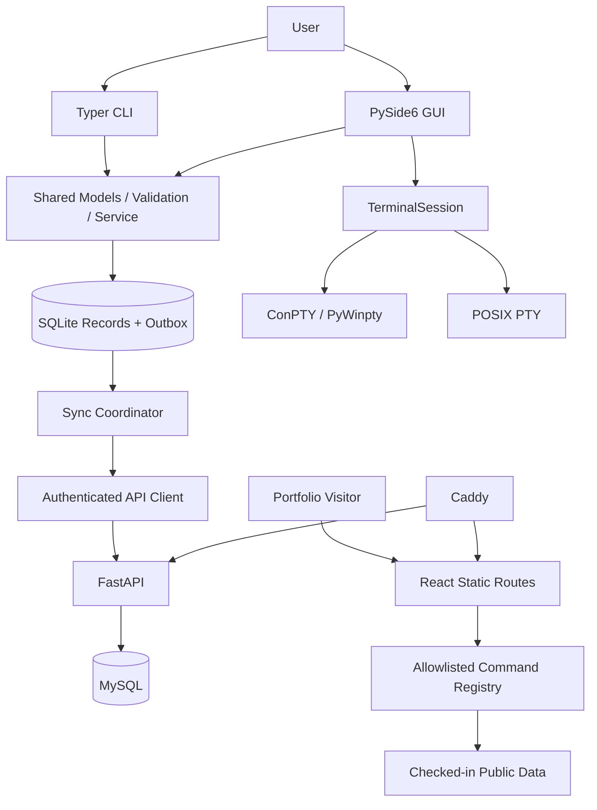

# MYCMD 2.0 - Complete Engineering Journey

> This document describes the development journey represented by the checked-in
> repository, commit history and phase reports. It distinguishes source-confirmed
> implementation, exact-SHA CI evidence and external limitations. It does not claim
> direct Kali testing, live public hosting or real MySQL backup rehearsal where those
> activities have not been performed.

## Prologue: from commands to a complete personal system

MYCMD began as a personal command-centre idea: projects, skills, education,
certificates and milestones were information that developers commonly maintain
across many separate tools. The original goal was not to produce a decorative
terminal. It was to create an application that could store, search, maintain and
eventually synchronize genuine personal records.

That distinction shaped the project. A CLI command such as `mycmd projects list`
belongs to MYCMD. A command such as `cd`, `git`, `python` or `ls` belongs to the
host operating system. Pretending to recognize native commands with fabricated
output would make the application look like a terminal without providing terminal
behavior. The project therefore separated application commands from real process
execution and public browser interaction.

## Phase 0: establish a reproducible foundation

Phase 0 created the repository structure and the development workflow needed for
later phases. The foundation included:

- Python 3.13 project metadata
- `uv` lock and dependency workflow
- Hatchling packaging
- Ruff formatting and lint
- Strict mypy configuration
- pytest test directories
- GitHub Actions
- Environment documentation
- Reserved boundaries for CLI, GUI, terminal, storage, sync, API and portfolio code

The historical setup process encountered executable access and package-connectivity
problems before a normal development environment was available. Those problems are
retained as an engineering-recovery part of the project history, not as current
requirements. The later repository state uses a real lockfile and verified build
workflow.

**Exit evidence:** repository foundation, lockfile, quality configuration and CI
prepared in the project history.

**Current limitation:** historical evidence is not a substitute for independent
source and exact-SHA verification of later changes.

## Phase 1: domain models and durable SQLite

Phase 1 implemented the five shared entity types:

- Projects
- Skills
- Education
- Certificates
- Milestones

The core model rules cover required fields, text lengths, dates, enums, URLs,
project slugs and uniqueness. CRUD operations require a stable owner scope and
optimistic revision arguments.

SQLite became the local source of truth. The storage layer uses:

- A shared records table
- Owner and kind indexes
- Partial uniqueness indexes
- Transactional migrations
- Atomic record and outbox writes
- Device identity
- Tombstones
- Optimistic versions
- WAL and full synchronous settings

The important architectural decision was to keep storage and domain logic out of
widgets and CLI modules. CLI and GUI operations use `Service`, while SQLite
connections are created by the appropriate application boundary.

**Important verification:** reopen persistence, owner isolation, stale revisions,
rollback on forced outbox failure, backup corruption checks and schema preservation
were added to tests.

**Limitations:** these tests are strong local durability evidence, not a claim of
hardware power-loss testing.

## Phase 2: native CLI

Phase 2 converted the domain and storage work into an actual Typer application.
The CLI includes entity command groups, status, search, sync surfaces and
backup commands.

The CLI was also deliberately plain for automation. It avoids Rich border output
and ensures inaccessible data directories or invalid UUIDs produce concise exit
errors rather than traceback panels.

At the first phase boundary, a UTF-8 BOM in `pyproject.toml` caused cross-platform
CI trouble. It was removed and the corrective commit was verified across Windows
and Ubuntu CI.

**Technical lesson:** packaging metadata and text encoding are release concerns,
not just formatting concerns.

## Phase 3: a genuine operating-system terminal

The terminal required the strongest separation from the application command parser.
It introduced a typed `TerminalSession` and `TerminalBackend` protocol.

On Windows, the adapter uses PyWinpty with ConPTY. On POSIX systems, `pty.fork`
creates a controlling terminal and process group. The session API provides:

- Start and close lifecycle
- Incremental byte output
- Initial working directory
- Environment overrides
- PTY resize
- Interrupt
- Exit status
- Child cleanup
- Shell discovery

The Windows implementation supports CMD and Windows PowerShell, with optional
PowerShell 7 discovery. POSIX discovery attempts Bash, Zsh or `/bin/sh` according
to availability.

This phase was not a simulated terminal. Tests launch real shells and exercise
directory changes, pipes, redirection, Unicode, resizing, history, completion,
interrupt, EOF and process cleanup.

Detached descendants and shell-exits-first cleanup remain narrower verification
limits. Ubuntu CI validates the POSIX adapter but does not establish direct Kali
support.

## Phase 4: desktop GUI

Phase 4 introduced the PySide6 desktop. The GUI shares validation and persistence
with the CLI and consumes the existing terminal session API.

The desktop architecture includes:

- Main navigation
- Entity CRUD forms
- Dashboard summaries
- Terminal rendering
- Sync status
- Settings and themes
- Worker-threaded storage operations

Qt WebEngine renders bundled xterm assets. Navigation and request interception
limit local rendering to the bundled terminal page. JavaScript clipboard and remote
access settings are disabled, and shell output is transported as data rather than
interpolated HTML.

SQLite connections are owned by worker-thread boundaries rather than the Qt UI
thread. Blocking terminal and lifecycle operations are kept off the GUI event loop.

Review work also addressed lifecycle failures: shutdown now propagates native
termination failures and retains a session for retry rather than discarding it
after a failed close.

**Platform limitation:** native visible-desktop, screen-reader and Kali verification
remain separate from offscreen Windows/Ubuntu automation.

## Phase 5: public portfolio

The public surface is a separate React/TypeScript/Vite application in
`apps/portfolio`. It uses conventional routes and project detail routes.

The browser terminal has a deterministic command registry. It supports commands
for public profile, projects, skills, education, certificates, milestones,
contact and theme behavior. Unknown commands receive an unsupported or suggested
response. It does not import the terminal backend, open SQL connections or expose
a subprocess endpoint.

The frontend implementation includes:

- TypeScript and React pages
- Responsive layouts
- Themes and reduced motion
- Keyboard and assistive fallback
- Public data validation
- URL credential/private-host rejection
- Vitest unit/component tests
- Playwright desktop/mobile browser tests

The public application therefore demonstrates terminal-like interaction honestly:
it is a restricted portfolio interface, not a remote operating-system shell.

## Phase 6: API and MySQL

Phase 6 introduced FastAPI, SQLAlchemy and Alembic. The server provides:

- Health and public endpoints
- Bootstrap and login
- Refresh and logout
- Authenticated profile
- Owner-scoped entity CRUD
- Structured errors
- Optimistic versions
- CORS and rate limiting
- MySQL-backed CI tests

Argon2id protects password hashes. Refresh values are opaque and stored only as
hashes; refresh sessions can be revoked. Access tokens are signed short-lived JWTs.

A bootstrap singleton provides the single-owner design used by the project. Owner
identity is supplied by authentication, not by a client owner field.

Alembic migrations 001 and 002 establish the API and synchronization tables.
Exact-SHA CI with MySQL 8.4 verified migrations and API behavior.

## Phase 7: synchronization

Phase 7 connected the offline client to the server.

Server behavior includes:

- Authenticated push and pull
- Operation-id idempotency
- Transactional operation responses
- Durable change-log entries
- Ordered pull cursors
- Owner scope
- Tombstones
- Stale/out-of-order conflict preservation

The local coordinator:

- Recovers stale `in_flight` operations
- Retries bounded transient failures
- Persists retry and conflict state
- Replays duplicate operations safely
- Shows queue, cursor and conflict status

The CLI and GUI expose sync controls and conflict resolution. Keep-server,
keep-local and manual merge are distinct operations. Manual merge validates the
shared entity rules and queues a server-version-checked update.

**Verified:** exact-SHA Windows, Ubuntu, portfolio and MySQL CI passed for the
Phase 7 implementation.

**Limitation:** Kali-specific verification, external production deployment and
hardware-failure tests remain separate from the CI evidence.

## Phase 8: hardening

Phase 8 focused on security, failure behavior and recovery.

The implementation added:

- SQLite snapshot backup and verification
- Encrypted SQLite backup and restore
- Restore-failure rollback coverage
- 10,000-record list benchmark
- Dependency vulnerability audit
- Updated vulnerable dependency floors
- Repository-wide lint and strict mypy gates
- CLI, server, storage and GUI regression coverage

The 10,000-record benchmark initially failed on this development hardware at
463 ms. Positional `Record` construction replaced a dictionary and
`dataclass`-field copy path, and the benchmark passed at the 250 ms target in
the focused rerun.

This result does not establish every hardware configuration. It is reproducible
test evidence on the executing environment.

Phase 8 exact-SHA CI passed Windows, Ubuntu, portfolio and MySQL matrix jobs.

**Remaining limitation:** direct Kali and external infrastructure rehearsal
remain outside the evidence.

## Phase 9: packaging

Phase 9 added PyInstaller packaging for the desktop application.

The `.spec` bundles:

- The GUI entry point
- Bundled terminal JavaScript/CSS/HTML
- PySide6 modules
- Terminal and GUI hidden imports

The Windows executable was built locally and remained alive under an offscreen Qt
smoke for twelve seconds. CI then builds and uploads packaged executables on both
Windows and Ubuntu.

The packaging extra was initially missing from the quality-gate environment.
After CI exposed it, the workflow synchronized `packaging` before building.

**Verified:** exact-SHA Windows and Ubuntu packaged GUI builds.

**Not verified:** clean-machine/Kali installer launch and external code-signing
identity.

## Phase 10: deployment preparation

Phase 10 added deployment assets rather than an asserted production launch.

The repository now includes:

- `Dockerfile.api`
- `compose.production.yaml`
- `Caddyfile`
- Production configuration validation
- Encrypted logical MySQL backup and restore helper
- Disposable migration downgrade/upgrade rehearsal helper

Production settings require MySQL, strong signing and bootstrap secrets, and
origin-only HTTPS CORS values. Development mode remains usable for local SQLite
and HTTP testing.

The API container applies Alembic migrations before starting Uvicorn. Caddy serves
the static portfolio and routes API paths to the API container.

**Exact-SHA verification:** CI run `45698439710` at commit
`4373a70bb11eb153d38691f0c814ca85741357ed` passed Windows, Ubuntu, portfolio and
MySQL matrix jobs.

**External blockers:** public DNS, ACME certificates, live hosting, real MySQL
backup/restore rehearsal and service rollback have not been performed. These are
deployment evidence gaps, not features claimed as complete.

## Engineering difficulties and fixes

The project history contains several categories of problem.

### Foundation and packaging

Environment access, lock resolution and build isolation interrupted early work.
The solution was a real frozen lock and isolated build workflow rather than
fabricated success or an unverifiable dependency state.

### Terminal lifecycle

Native process cleanup and WebEngine lifecycle interact across threads. Failures
could otherwise leave a session open or discard a close retry. Lifecycle code now
retains sessions until cleanup succeeds and propagates shutdown failures.

### Synchronization ambiguity

Offline mutations require idempotency, stale acknowledgments and conflict storage.
The implementation uses durable operation IDs and server-returned original
responses instead of assuming that a retry means a successful new mutation.

### Backup integrity

Checksums detect accidental corruption but do not by themselves prove authenticity.
The encrypted backup format uses a separate password-derived key and sidecar
metadata. Restore still verifies the staged database before replacing the live
database.

### CI packaging

A local build can pass while a clean runner lacks an extra dependency or platform
library. The phase gates synchronize all relevant extras and upload OS artifacts.
CI failures are repaired and rerun at exact SHAs rather than hidden behind partial
success reports.

## GitHub contribution history

The repository is owned by `Yousif-Sahito/MYCMD`, and GitHub CLI authentication
is active for `Yousif-Sahito`. The local repository config currently uses
`Muhammad Yousif` and `muhammadmuhammadyousif0811@gmail.com`.

Historical implementation commits alternate among:

- The local human-author identity
- GitHub Copilot automation commits
- Agent checkpoint commits

The exact association of the human email with the GitHub account must be established
through GitHub account email settings; this document does not assume that an
unverified email is linked.

Existing public history must not be rewritten merely to improve contribution
counts. Safe attribution corrections are:

1. Add the human email to GitHub account email settings if controlled and verified.
2. Keep repository-local future author configuration accurate.
3. Use Copilot or agent identities only for automated co-work that actually occurred.
4. Preserve public commit hashes and dates.

## Verification status

### Verified

- Core domain and SQLite CRUD
- CLI registration and persistence
- Real Windows and POSIX terminal sessions
- PySide6 navigation and terminal integration
- Public portfolio and allowlisted commands
- FastAPI/MySQL API and auth
- Push/pull, cursors and conflict storage
- SQLite and encrypted backup formats
- 10,000-record benchmark on an executed test environment
- PyInstaller Windows and Ubuntu builds
- Windows/Ubuntu/MySQL/portfolio exact-SHA CI

### Implemented but externally limited

- Public HTTPS deployment assets
- Encrypted MySQL backup helpers
- Migration rollback/forward rehearsals
- Clean packaged GUI smoke
- Ubuntu POSIX packaging

### Not verified

- Direct Kali desktop and terminal compatibility
- Live public DNS/ACME deployment
- Real MySQL backup restore rehearsal
- Service rollback on production infrastructure
- Hardware power-loss durability
- Full screen-reader and native accessibility certification

## Current architecture

## Lessons learned

1. Shared domain rules prevent CLI and GUI data behavior from diverging.
2. Real terminal adapters are process engines, not text-only command mocks.
3. Qt worker threads and native process cleanup need explicit lifecycle ownership.
4. Idempotency and durable acknowledgments are as important as HTTP mutation calls.
5. A checksum is integrity evidence, not authentic provenance.
6. Exact-SHA CI prevents undocumented drift between source and release claims.
7. Skips and platform limitations must remain visible.
8. Documentation is part of software engineering, not a final cosmetic step.

## Future roadmap

- Direct Kali build, launch and terminal verification
- Clean Windows and Kali installers
- Real DNS/ACME/Caddy production rehearsal
- Disposable MySQL backup/restore and rollback rehearsal
- OS-keyring recovery and secret rotation documentation
- Hardware power-loss-style durability testing
- Coverage reports and risk-based mutation testing
- Container SBOM and image vulnerability scanning
- Tagged releases with checksums
- Continued audit reports and issue-driven maintenance

## Final status

MYCMD 2.0 contains a complete local application core, real native terminal engine,
PySide6 desktop, restricted public portfolio, FastAPI/MySQL backend, offline sync,
backup capabilities and packaging/deployment assets.

The project is verified as a source and CI implementation through Phases 0-10, with
external infrastructure and Kali limitations recorded honestly. It should be
presented as a mature engineering project, not as a live publicly hosted service.
